# Dolores AR

App turística con **realidad aumentada** para visitar Dolores Hidalgo, Guanajuato.
Desarrollo Móvil Integral · UTNG

## ¿Qué hace?

- **RA por ubicación:** con GPS + brújula calcula qué lugares quedan frente al usuario y dibuja etiquetas con su nombre y distancia.
- **Pasaporte turístico:** se gana un sello al acercarse a menos de 40 m de un lugar.
- **Modelo 3D:** muestra un modelo 3D con `model_viewer_plus` (ARCore / Quick Look).
- **Modo demo:** simula la posición y la brújula (con un deslizador) para practicar sin estar en Dolores Hidalgo.

## Pruebas

    flutter test

## Evidencia de TDD (ciclo Rojo → Verde por ronda)

En cada ronda se escribe primero la prueba, se ve fallar (rojo), se implementa lo mínimo para que pase (verde) y después se mejora el código.

### Ronda 1: Geo (cálculos de ubicación)
**Rojo:** la prueba falla porque aún no existe `geo.dart`.

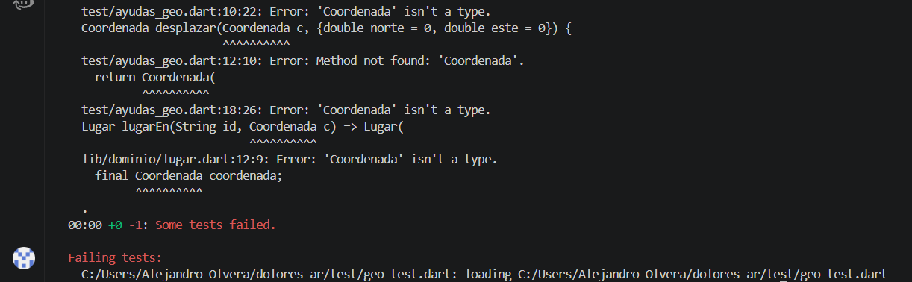

**Verde:** con `geo.dart` implementado, la prueba pasa.

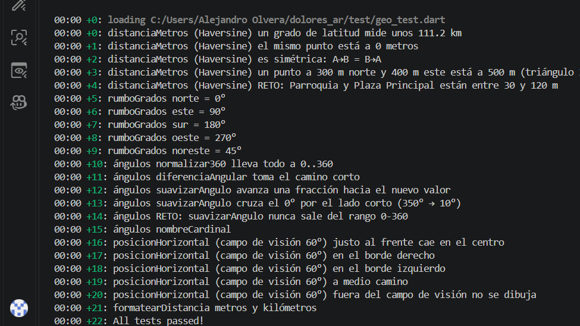

### Ronda 2: Motor de RA
**Rojo:**

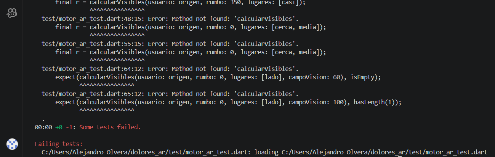

**Verde:**

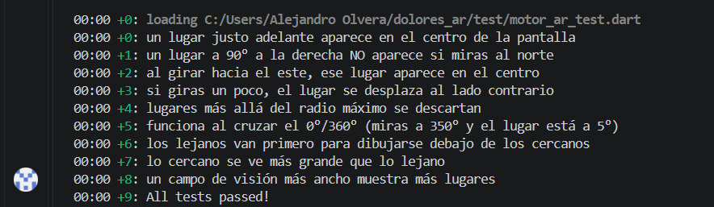

### Ronda 3: Pasaporte
**Rojo:**

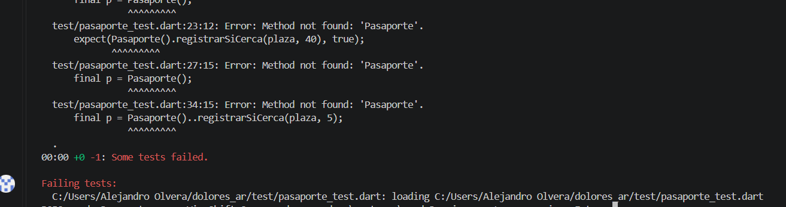

**Verde:**

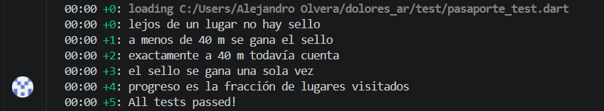

### Ronda 4: ARViewModel
**Rojo:**

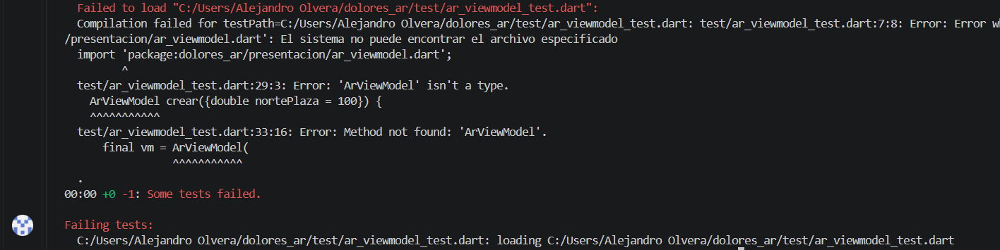

**Verde:**

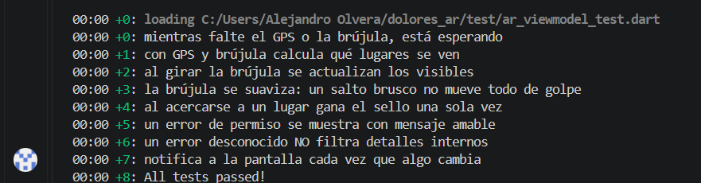

### Resultado final: todas las pruebas pasando
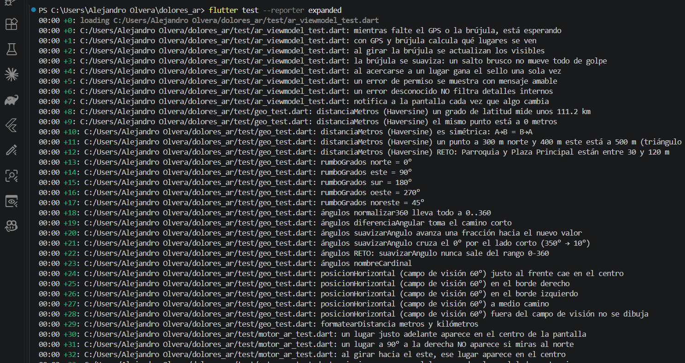
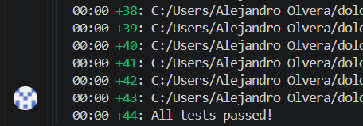
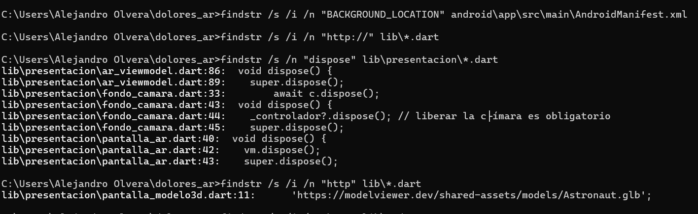

Cubren distancia, rumbo, cruce del norte, campo de visión, motor de RA, pasaporte y ViewModel.

## Evidencias

### Funcionamiento de la App
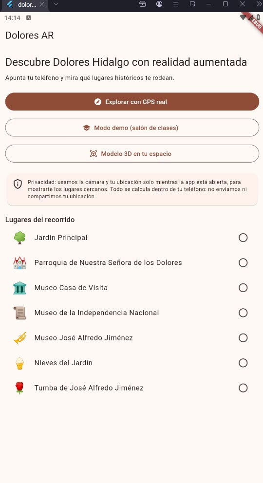
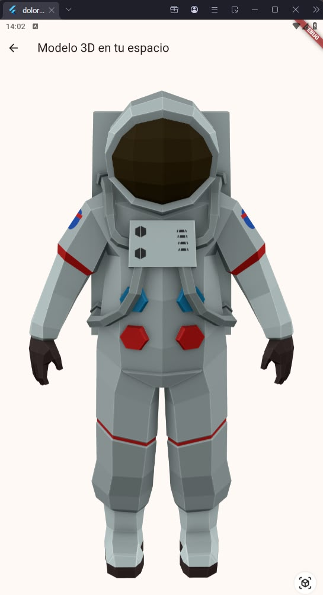
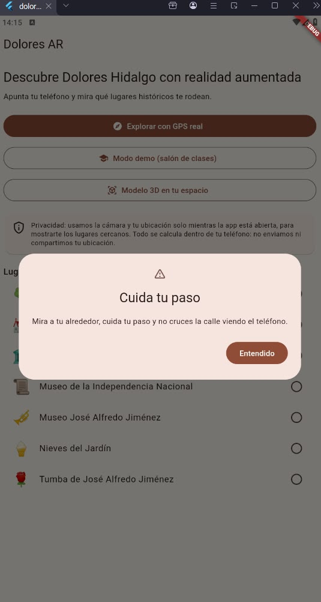
